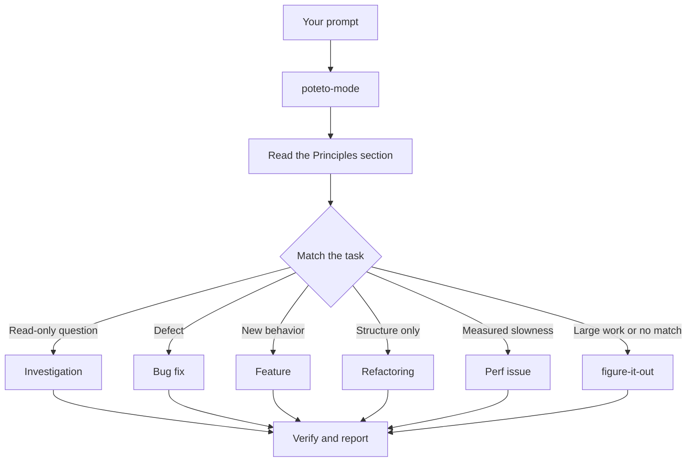

# Roteie o trabalho pelo `/poteto-mode`

`/poteto-mode` é a porta de entrada. Você dá um objetivo, ele casa com um dos vinte e dois playbooks, copia os passos desse playbook para a lista de tarefas, e chama as outras skills conforme os passos precisam. Nesta página você aprende como é um bom prompt, e quão pouco de um você de fato precisa.


## O que acontece com seu prompt



O diagrama mostra as rotas comuns. Existem também playbooks para hillclimb de uma métrica, diagnóstico de sintomas de runtime e traces capturados, protótipos, paridade visual, autoria e avaliação de skills, execuções autônomas, abertura de PR, babysit de um PR ou pilha até o ponto de merge, entrega de uma pilha verificada, rodar uma fila de PRs ou uma pilha no piloto automático, retomada de sessão, pausa segura, planos multifase, e limpeza de worktrees. O [diretório de playbooks](../../.agents/skills/poteto-mode/playbooks) tem o conjunto completo.

## Diga o objetivo, não a cerimônia

Você não escreve uma spec. Você diz o que está errado ou o que quer, mais qualquer coisa que já saiba e economize tempo do agente:

```text
/poteto-mode users get two notifications after a retry. repro first, then fix and verify.
```

Esse é um prompt de Bug fix. "repro first" é uma restrição real, não gentileza, e o playbook honra ela. Veja a lista de tarefas encher com os passos de Bug fix.

## O que entra num prompt

Um prompt útil carrega até cinco coisas, e cada uma cabe numa frase:

- **O objetivo.** Diga o que está errado, ou o que você quer.
- **A checagem de pronto.** Ela precisa poder passar ou falhar. "Make it better" e "work on it for an hour" não são checagens.
- **A prova que você quer ver.** Peça a saída real do comando, um vídeo do fluxo, o valor armazenado, ou um número de antes e depois.
- **O que você já sabe.** Um sintoma, um passo de repro, uma linha de log, ou um link economiza uma busca do agente.
- **As restrições reais.** "repro first", "don't change any code yet", "zero behavior change" e "let me review before proceeding" mudam cada uma o que o agente faz.

Aqui está um prompt com as cinco:

```text
/poteto-mode the csv export drops its last row since yesterday's deploy. failing job id is 4812. repro first, then fix. done means the 60k-row fixture exports every row. show me the row counts before and after.
```

Duas coisas vale deixar de fora:

- **O como.** Diga o que alcançar, e deixe espaço para o agente achar um caminho melhor que o seu. O mesmo vale para uma lista de skills, coberta na armadilha abaixo.
- **Sua teoria da causa, no começo.** Um palpite declarado estreita a busca para onde você apontou. Deixe o agente reformular o problema antes de você compartilhar sua intuição.

Para um relato barulhento, como uma thread longa ou um bug vago, faça da reformulação o primeiro passo:

```text
/poteto-mode read this thread. restate the underlying issue in your own words, in plain english. don't change any code yet.
```

Uma leitura errada aparece na reformulação, antes de existir qualquer código. Corrija ali, e custa uma mensagem em vez de uma correção errada. Para só a reformulação, sem playbook, rode [`/in-your-own-words`](../../.agents/skills/in-your-own-words/SKILL.md). Ele reformula o que o agente acha que são seus objetivos e que problema você tenta resolver.

Quando você não tem certeza se um prompt está apontado certo, rode [`/sharpen`](../../.agents/skills/sharpen/SKILL.md) nele antes de enviar:

```text
/sharpen write a migration guide for the v2 config format.
```

O agente diz o que um profissional de ponta faria que você não pediu, o material mais cru de onde ele começaria, os métodos e ferramentas que usaria, e o que além de você ou do agente mostraria que o resultado está certo. Depois reescreve seu prompt para pedir exatamente isso, mais fundo mas não maior. A reescrita pede que o agente prototipe qualquer escolha que um experimento resolva e recomende uma opção a partir do que observou, e deixa escolhas de produto e preferência com você. Ela não faz a tarefa. Leia a reescrita, depois envie, por exemplo com `/poteto-mode`.

## Continue curto

Quando a conversa já carrega o contexto, o prompt encolhe para quase nada. Todos estes bastam:

```text
/poteto-mode do it
```

```text
continue
```

```text
keep going until done
```

Curto funciona porque o playbook segura a estrutura, e um Custom Mode mantém `/poteto-mode` em contexto a cada turno. [Configure o pstack](./01-setup.md#run-your-first-task) mostra como iniciar um. Suas palavras carregam a intenção, e a skill carrega o rigor.

## Troque de tarefa com "new task"

Um chat longo acumula contexto da tarefa anterior. Quando você muda de assunto, diga:

```text
/poteto-mode new task. figure out why the cache entry survives logout. don't change any code yet.
```

"new task" diz ao `/poteto-mode` para casar de novo em vez de continuar o playbook anterior. "don't change any code yet" prende esta a Investigation. Sem essas duas frases, um modo no meio de Feature tende a tratar sua pergunta como o próximo passo da feature.

## Dê máquina própria ao trabalho paralelo

Se você roda vários agentes contra um repositório numa máquina, eles vão brigar pela árvore de trabalho, pelas portas e pela saída de build. O isolamento mais limpo é um [subagente de nuvem](https://cursor.com/docs/subagents#cloud-subagents). Cada um ganha sua própria VM e branch, então pode instalar dependências, rodar seu app, e gravar vídeo do resultado sem tocar na sua máquina. Digite `/in-cloud` antes da tarefa, ou peça ao chat pai que passe trabalho para subagentes de nuvem.

Quando o trabalho tem que ficar local, peça um worktree desde o início:

```text
/poteto-mode new task. branch off <base> in a fresh worktree, then port the parser change there.
```

Cada tarefa em seu próprio branch e worktree significa que nenhum agente pisa nos arquivos do outro. Worktrees custam disco e recursos da máquina, então um laptop roda só um punhado por vez. O [Opening a PR playbook](../../.agents/skills/poteto-mode/playbooks/opening-a-pr.md) já trabalha a partir de um worktree para mudanças de código, então na maioria das vezes você só diz isso quando uma base ou local específico importa.

Worktrees se acumulam. Quando o disco apertar, peça:

```text
/poteto-mode what's eating my disk? prune the worktrees that are safe to prune.
```

O [Worktree cleanup playbook](../../.agents/skills/poteto-mode/playbooks/worktree-cleanup.md) classifica cada worktree por estado de merge, trabalho não commitado, e quais chats ainda tocam nele. Ele apaga só o que essa evidência libera e pausa para você decidir sobre qualquer coisa com trabalho não commitado.

## Deixe rodando

Quando você se afastar, diga o que significa pronto e vá:

```text
/poteto-mode im stepping away. keep going until the migration check reports zero old callers. log your decisions.
```

Trabalho que você vai revisar depois passa por [`/figure-it-out`](../../.agents/skills/figure-it-out/SKILL.md), que desenha as fases da execução e mantém um log de decisões do [`/show-me-your-work`](../../.agents/skills/show-me-your-work/SKILL.md). [Rode trabalho enquanto dorme](./07-overnight.md) cobre o contrato noturno completo.

**Armadilha:** não enumere skills no seu prompt ("use /architect, then /arena, then /interrogate..."). O playbook já sequencia elas, e uma sequência escrita na mão costuma reordenar ou derrubar passos que o playbook manteria. Nomeie uma skill só quando você quer sobrepor uma escolha específica.

Leia [`poteto-mode`](../../.agents/skills/poteto-mode/SKILL.md) em si para as regras completas de roteamento.

Próximo: [Entenda o código](./03-understand.md).
