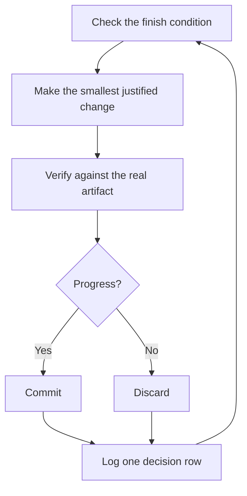

# Rode trabalho enquanto dorme

Este é o retorno de tudo o que veio antes. Um agente em quem você confia para verificar o próprio trabalho é um agente que você pode deixar sozinho com uma tarefa difícil. O que torna isso seguro não é esperança. É uma condição de término verificável, um worktree isolado ou agente na nuvem, e um log de decisões que você audita de manhã.


## Ganhe a confiança antes do laço

Um laço em que você não confia só produz trabalho não checado mais rápido, e a bagunça se acumula a cada iteração. Antes de deixar um rodando, confira se ele mereceu:

- Você já fez a tarefa uma vez na mão, ou viu um agente fazer, então sabe como é o bom resultado.
- O agente tem as ferramentas e os sinais que você mesmo usaria. A skill de verificação, o profiler, os logs.
- Cada estágio prova seu trabalho e consegue parar a linha quando o trabalho fica abaixo da régua.
- Você leu algumas transcrições e transformou as falhas repetidas em ferramentas, skills ou checagens.

Só torne o laço autônomo depois que os quatro valem. Até lá, rode olhando.

## O contrato da noite

Uma boa passagem de bastão tem o objetivo, a condição de término, as permissões e uma saída de emergência. Não precisa ser longa:

```text
/poteto-mode im going to bed. migrate every caller to the new parser in a fresh worktree off <base>.
done means zero old callers, all parser fixtures pass, old api deleted.
keep a decision log. don't ask me before committing.
/loop until done. if you're truly stuck after a few hours, stop and write up why.
```

Veja o que cada linha compra:

- "im going to bed" é uma substituição de sessão. O agente para de perguntar e segue.
- "done means..." transforma o objetivo em checagens que toda iteração consegue rodar.
- "fresh worktree off `<base>`" impede que a execução colida com qualquer outra coisa que você tenha aberta.
- "don't ask me before committing" responde antes a permissão em que o agente travaria.
- O `/loop` é o mecanismo de despertar nativo do Cursor, não uma skill do pstack. O [playbook Autonomous run](../../.agents/skills/poteto-mode/playbooks/autonomous-run.md) usa ele para rechecar a condição de término em eventos ou num heartbeat.
- A saída de emergência deixa ele parar num beco sem saída de verdade e escrever o porquê, o que é melhor que oito horas de reinterpretação criativa do objetivo.

Como você vai revisar esse trabalho depois de sair, o `/poteto-mode` roteia ele pelo [`/figure-it-out`](../../.agents/skills/figure-it-out/SKILL.md), que desenha as fases da execução antes de qualquer código e liga o log de decisões.

Para parar uma execução de propósito, diga ao agente para pausar, ou que você vai ficar offline ou reiniciar o Cursor. O [playbook Pause safely](../../.agents/skills/poteto-mode/playbooks/pause-safely.md) termina ou desfaz o passo atual, commita um checkpoint de trabalho em andamento, e escreve uma nota de retomada. Um chat novo pega o trabalho dessa nota pelo playbook Session pickup. Dizer "keep going" nunca dispara uma pausa.

## O que o laço faz a noite toda



Uma mudança, uma checagem, uma linha de log, a cada iteração. Mudanças que não ajudaram são descartadas, não deixadas para seguir. Um platô significa mudar de rumo, não parar, e a condição de término nunca relaxa em silêncio para declarar vitória.

## A auditoria da manhã

O [`/show-me-your-work`](../../.agents/skills/show-me-your-work/SKILL.md) é o que torna a execução revisável. Cada linha registra a hora, a fase, a decisão, o motivo, um ponteiro de evidência e o resultado, num TSV em `decisions.tsv` (ou `.audit/<task-slug>.tsv` quando várias execuções compartilham um diretório). Ele fica local por padrão. Commite quando o trabalho é ambicioso o bastante para um revisor precisar da trilha para confiar no resultado.

Quando você voltar, peça a execução em formato de revisão:

```text
/show-me-your-work catch me up on what you did last night
```

Antes de a skill devolver o resumo, ela cria um revisor numa família de modelo diferente para ler a trilha e a transcrição, e a resposta termina com uma seção Attention listando o que merece seu escrutínio. Leia essa seção primeiro, depois as linhas de log que ela aponta. Você está auditando decisões, não relendo a noite inteira.

Para um status rápido em vez de uma auditoria, rode o [`/ketchup`](../../.agents/skills/ketchup/SKILL.md) no chat que rodou o trabalho. Ele só lê, e diz em palavras simples o que mudou desde a sua última mensagem, com as capturas de tela e os diagramas pequenos que o trabalho produziu. Depois lista cada chamada esperando você, como um merge, uma aprovação ou uma escolha entre opções, com a escolha dele, a evidência e o risco, para você decidir só pela resposta.

## Quando a noite tem uma fila, não uma tarefa

O contrato acima leva uma tarefa a uma condição de término. Algumas noites têm mais, uma fila de mudanças independentes ou um programa inteiro. Dois playbooks e uma skill escalam a mesma confiança.

O [Autopilot-full](../../.agents/skills/poteto-mode/playbooks/autopilot-full.md) leva uma fila de PRs independentes até o merge. Cada PR ganha um agente dono que o carrega da construção ao merge, e nenhum dono faz merge com o próprio veredito. Um swarm de verificadores novos checa a cabeça de código pronta do dono. Um rebase ou correção menor posterior ganha um verificador novo, e só comportamento novo ou um diff novo grande chama o swarm inteiro de novo. Só um veredito limpo no patch que faz merge autoriza o merge:

```text
/poteto-mode full autopilot on this queue. each item is independent. i want them merged by morning.
```

O [Autopilot-stack](../../.agents/skills/poteto-mode/playbooks/autopilot-stack.md) é o Autopilot-full sem o merge. Você acorda com PRs verificados, cada um com seu veredito, e revisa e aterrissa eles você mesmo. Um PR empilha só sobre um PR em que ele se baseia. Escolha ele em vez do Autopilot-full quando quiser seus próprios olhos no trabalho antes de qualquer merge:

```text
/poteto-mode autopilot these five changes, but don't merge. i'll land them in the morning.
```

Um programa inteiro, como uma migração por muitos pacotes, não tem playbook próprio. O `/poteto-mode` roteia trabalho grande ou transversal para o [`/figure-it-out`](../../.agents/skills/figure-it-out/SKILL.md), que desenha uma execução rigorosa para ele:

```text
/poteto-mode migrate every package to the new store. own it until each one is converted and merged. i'll check in twice a day.
```

## Rode muitos projetos em paralelo

Um [Cursor Project](https://cursor.com/blog/projects) dá a um agente coordenador uma thread persistente. O coordenador não escreve código. Ele dirige subagentes, que rodam na nuvem por padrão, então o trabalho continua com seu laptop fechado. Comece seus prompts ao coordenador com `/poteto-mode`, e os subagentes que ele cria seguem os playbooks. Cada agente que ele inicia lê o [`worker.md`](../../.agents/skills/poteto-mode/worker.md) primeiro, então os workers mantêm a régua do kickoff, decidem chamadas reversíveis em vez de perguntar a você, e abrem PRs prontos para revisão.

Alguns hábitos ajudam:

- Dê a cada bloco de trabalho o seu Project, como uma funcionalidade, uma migração, um esforço de perf ou uma limpeza de dívida técnica. Vários podem rodar lado a lado.
- Arraste chats relacionados para o Project, inclusive os terminados. Eles viram contexto para todo agente nele.
- Dê a cada PR um swarm de verificação antes do merge, e deixe o Autopilot-stack ou o Autopilot-full carregar a fila.
- Peça ao coordenador um plano apoiado em dados, e faça ele responder perguntas abertas com protótipos antes de perguntar a você.

Um prompt carrega um Project inteiro, da pesquisa à execução:

```text
/poteto-mode refactor this repo so its architecture is more agent friendly. use /correct and /architect on past commits and review comments to find the mistakes agents make most here. use /recall for context from past chats. answer open questions with prototypes instead of asking me. come back with a plan backed by real data. once i approve it, run it with autopilot-stack or autopilot-full, and ask me which.
```

## Deixe os laços se iniciarem sozinhos

Todo laço acima ainda espera você iniciar. Uma automação agendada ou movida a evento remove esse passo. A manutenção de software se divide em estágios que caem bem nisso. Triagem de um relato, reprodução, correção, verificação da correção. Duas regras mantêm essa linha confiável:

- Todo estágio consegue parar a linha. A triagem pode decidir que o relato é comportamento esperado, o repro pode não conseguir reproduzir, e o corrigidor pode julgar a mudança arriscada demais. Cada um desses desfechos é útil, porque impede que trabalho ruim chegue ao estágio seguinte, onde desfazer custa mais.
- Todo estágio entrega evidência. O repro anexa capturas e vídeo do estado quebrado, e a correção anexa prova de antes e depois. Um humano consegue então checar se o agente corrigiu a coisa certa antes de ler uma linha de código.

Na origem, o pstack entregava isso como um pacote de automação dormente para relatos de issue no Slack: uma automação fazia a triagem de cada relato e outra reproduzia bugs confirmados e preparava um rascunho pequeno de correção. Esse pacote usava Automations do Cursor e não vem neste pacote adaptado. Para montar o equivalente, siga o substituto no [mapa de Antigravity](../harness/antigravity.md): Dynamic Workflow agendado, ou um script `cron` chamando o Antigravity CLI.

**Armadilha.** Uma duração não é condição de término. "work on this for 4 hours" não dá nada ao agente para checar, e você acorda com quatro horas de movimento em vez de um resultado. Dê ao `/loop` um predicado que passa ou falha.

Próximo: [Direcione por nomes de princípio](./08-principles.md).
