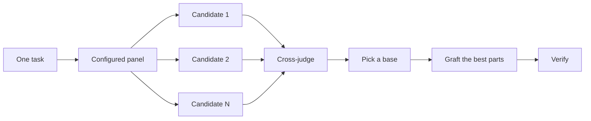

# Desenhe antes de escrever código

Uma tentativa num design difícil trava a primeira forma que o modelo pensou. `/architect` resolve tipos e fronteiras antes da implementação. `/arena` roda várias tentativas do mesmo briefing e junta as melhores partes. `/interrogate` põe outros modelos para tentar quebrar o resultado. Quando o trabalho é cobertura e não síntese de design, `/swarm` abre fatias ou corridas e agrega os resultados.

Os dois erros de design mais comuns são aceitar o primeiro design do agente e polir um plano que nenhum código testou. Esta página corrige os dois. Você planeja através de código. Protótipos respondem as perguntas abertas, um README ou tutorial define o alvo, e o plano escrito vem por último.


## Resolva a forma com `/architect`

```text
/architect design the import pipeline before writing any code. i care most about how callers use it.
```

[`/architect`](../../.github/skills/architect/SKILL.md) rastreia primeiro todo sistema que a mudança toca. Depois esboça duas formas diferentes, cada uma com tipos, assinaturas e fronteiras de módulo, e escolhe a em que cada pedaço de estado tem um dono, cada tarefa tem um jeito de ser feita, e os chamadores precisam saber o mínimo. Para um design grande ou contestado, ele roda `/arena` em vez de esboçar sozinho. Se você quer ver o design antes de qualquer código, diga no prompt.

O design não é sagrado depois que o código começa. Se o mesmo contorno volta sempre, `/architect` redesenha em vez de remendar em volta.

## Abra tentativas com `/arena`

```text
/arena take my prompt to the arena verbatim. i want to compare their proposals with yours.
```

[`/arena`](../../.github/skills/arena/SKILL.md) é a ferramenta geral por baixo. N subagentes tentam o mesmo briefing de design ou código em paralelo, cada um escrevendo no seu próprio worktree ou diretório. Um juiz somente leitura de um fornecedor de modelo diferente pontua cada candidato contra uma rubrica. Quando nenhum modelo de outro fornecedor pode rodar, o coordenador pula o juiz e escolhe a base ele mesmo. O coordenador lê cada candidato de ponta a ponta, escolhe uma base, enxerta as melhores ideias dos perdedores, e verifica o resultado.



O painel vem da sua configuração do [`/setup-pstack`](../../.github/skills/setup-pstack/SKILL.md), e você pode ajustar por tarefa. Peça mais candidatos quando a decisão importa, menos quando não:

```text
/arena this, 5 candidates. the cache key format is expensive to change later.
```

## Cubra fatias e corridas com `/swarm`

```text
/swarm check every package under packages/ against its check.sh. one worker per package. one report.
```

[`/swarm`](../../.github/skills/swarm/SKILL.md) abre N workers por fatias independentes, matrizes de cobertura, raias de gauntlet, partições de exploração, ou braços de corrida declarados. Cada worker ganha seu próprio escopo e checagem, depois reporta `PASS`, `ISSUES` ou `BLOCKED`. O pai espera os workers e devolve um relatório compacto com quaisquer lacunas ou desistências.

Use quando o paralelismo compra cobertura ou deixa checagens independentes correrem. `/arena` dá a todo worker o mesmo briefing de design ou código, depois escolhe uma base e enxerta as melhores partes. `/swarm` cobre fatias ou roda uma corrida com uma regra de seleção declarada de antemão. Ele não usa a cerimônia de escolha de base e enxerto.

## Quebre com `/interrogate`

```text
/interrogate the whole branch, but skeptically. no nitpicks unless it's an actual bug or regression.
```

[`/interrogate`](../../.github/skills/interrogate/SKILL.md) entrega a mudança e a intenção dela a adversários nos modelos configurados, e cada um tenta quebrar com uma execução contra o código real. Adversários encontram falhas diferentes. Um achado só sobrevive quando rodar o comando dele de novo mostra uma falha que quebra a intenção. O relatório lista cada achado verificado com os adversários que o encontraram, depois o que cada adversário descartou e por quê, e não aplica nada.

Leia a lista Dropped também. Você pode sobrepor o veredito.

## Prototipe em vez de debater

Nunca aceite o primeiro design. Peça alguns, e escolha a partir de evidência que você pode ver:

```text
/poteto-mode prototype a few options for the new dropdown menu. take screenshots or videos for me to compare.
```

O [Prototype playbook](../../.github/skills/poteto-mode/playbooks/prototype.md) constrói esboços descartáveis num diretório de rascunho, põe as variantes atrás de um seletor, dirige cada uma, e captura telas ou tempos. Ele funciona para comportamento e algoritmos também, não só UI. Protótipos são planejamento com código. Eles deixam o agente responder as próprias perguntas abertas rodando algo em vez de perguntar a você, e abrem espaço para uma opção que você não teria pensado.

A mesma ideia escala para um design real. Combine `/architect` com protótipos e mantenha um portão de revisão:

```text
/poteto-mode we need rate limiting for external webhooks. /architect it first, and answer open questions with prototypes. let me review before proceeding.
```

Não gaste adversários num plano abstrato. `/interrogate` descarta todo achado que uma execução não prova, então um plano sem código atrás dá pouco para eles quebrarem. Deixe os protótipos resolverem as perguntas, depois revise o que foi construído.

## Escreva o README primeiro para código compartilhado

Para um pacote ou API que outro código vai usar, comece pelo documento que um usuário leria:

```text
/poteto-mode write a tutorial for how i would use the new config package first. then /teach me why it beats the current one.
```

Escrever o tutorial primeiro força a visão do chamador. Você descreve a API para um usuário hipotético e volta para a implementação. O documento também vira um alvo concreto contra o qual o agente checa o próprio trabalho. Nomeie [`/technical-writing`](../../.github/skills/technical-writing/SKILL.md) quando o documento em si importa, para um tutorial continuar tutorial em vez de derivar para referência e explicação ao mesmo tempo.

## Planeje depois que o design assentar

O pstack não tem skill de planejamento, de propósito. Quando você quer um plano escrito, peça depois que o design assentar:

```text
/poteto-mode turn this design into a plan. small verifiable PRs, each with its own verification steps.
```

O [Multi-phase plan playbook](../../.github/skills/poteto-mode/playbooks/multi-phase-plan.md) resolve qualquer pergunta aberta restante por protótipo, depois escreve uma seção por PR, cada uma terminando em prova de que a mudança funciona. Uma suíte de testes passando sozinha não conta como essa prova. O plano é a entrega. O playbook não implementa ele, e a execução começa só quando você manda.

Para uma migração, declare a régua no prompt:

```text
/poteto-mode plan the migration of our ui library to the new styling system. small verifiable PRs, each with visual regression checks. the result must match the original exactly, bugs included.
```

"bugs included" impede a migração de corrigir coisas em silêncio no caminho, o que tornaria impossível comparar a saída antiga e a nova. Para um projeto que dura muitos dias, você pode commitar o plano no repositório por um tempo para outros agentes verem o trabalho em andamento. Apague quando o trabalho aterrissar.

## Quanto trabalho de design uma tarefa merece?

Você pode estar se perguntando se toda mudança precisa disso. Não. A maioria não precisa de nada disso. Uma escada aproximada.

- Uma mudança pequena e acabada sobre a qual você tem dúvida precisa só de `/interrogate`.
- Uma mudança que atravessa fronteiras de função ou move propriedade ganha `/architect`, que traz `/arena` junto quando o design é grande ou contestado.
- Uma decisão isolada em que tentativas independentes ajudariam, como nomes, formatos ou um algoritmo, é `/arena` direto.
- Uma matriz de cobertura, conjunto de checagens paralelas, ou corrida com braços declarados é `/swarm`.
- Uma pergunta aberta que você responderia rodando algo, como um layout, um tempo, ou uma abordagem, ganha um protótipo, não um debate.
- Um design contestado e caro de reverter ganha `/architect`, depois `/interrogate` antes da entrega.
- Trabalho que atravessa vários PRs ganha um plano, escrito depois que o design assenta.

O `/poteto-mode` já aplica essa escada. Trabalho que cruza fronteiras dispara `/architect` sozinho, então você recorre a estes direto principalmente quando quer mais ou menos escrutínio que o padrão.

Próximo: [Construa e limpe a mudança](./05-build-and-clean.md).
